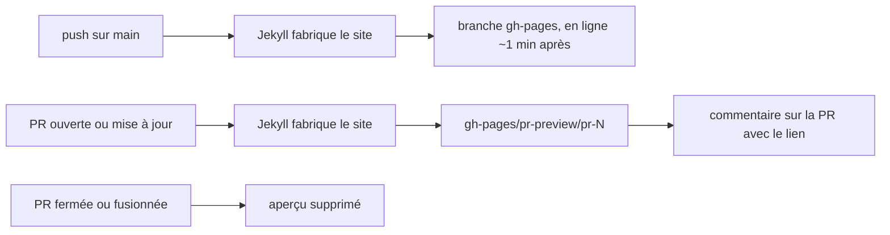

# Courir Fonsegrives

Site de Courir Fonsegrives, club de course à pied de Quint-Fonsegrives.

En ligne : https://courir-fonsegrives.github.io/

## Le dépôt

```text
_rubriques/          le texte de chaque rubrique (voir ci-dessous)
photos/
├── bureau/          les photos des membres du bureau
├── membres/         les photos du trombinoscope
├── apercu-liens.jpg l'image de l'aperçu des liens partagés (1200 × 630 pixels, tirée du logo)
└── logo.png         le logo carré que les moteurs de recherche affichent
index.html           la mise en page, les couleurs et le code ; assemble les rubriques dans l'ordre de la page
_includes/           deux morceaux de code repris par index.html (icônes des réseaux, texte pour le JSON)
_config.yml          les réglages de Jekyll, qui fabrique le site
robots.txt           pour les moteurs de recherche, avec sitemap.xml : ne pas les supprimer
sitemap.xml
.github/workflows/   la publication du site et les aperçus de PR
```

Les autres images et le PDF sont chargés depuis [courir-fonsegrives.fr](https://courir-fonsegrives.fr).

## Modifier un texte

| Fichier de `_rubriques/` | Rubrique |
|---|---|
| `accueil.md` | La grande photo, le titre et le bouton du haut. Le titre d'onglet et la description servent aussi à l'aperçu des liens partagés |
| `presentation.md` | « Course à pied, plaisir et convivialité… » |
| `lieux.md` | Les lieux et les quatorze parcours |
| `semaine.md` | Les trois sorties de la semaine |
| `balade.md` | La Balade de la Saune |
| `adhesion.md` | Les tarifs et comment adhérer |
| `bureau.md` | Les membres du bureau, leurs photos, l'adresse mail et la page Strava du club |
| `membres.md` | Le trombinoscope : la liste des membres et leurs photos |
| `partenaires.md` | Les partenaires du club, leur logo, leur site et leurs réseaux sociaux |
| `mentions.md` | Les mentions légales : éditeur, directeur de la publication, hébergeur, données personnelles |

Sur GitHub :

1. Ouvrir le fichier, puis cliquer sur le crayon (« Edit this file »).
2. Changer le texte.
3. Cliquer sur « Commit changes ». Le site est à jour environ une minute plus tard.

Pour déposer une photo : bouton « Add file », puis « Upload files ».

Un fichier a deux parties :

- **En haut, entre les deux lignes `---`** : les titres, les listes et les petits textes. Gardez les guillemets droits (`"…"`) autour de chaque texte. Pour citer, utilisez « ».
- **En bas, après le second `---`** : les paragraphes, en Markdown. Laissez une ligne vide entre deux paragraphes. Un lien s'écrit `[texte du lien](https://adresse)`.

## Les changements courants

**Trombinoscope** (`membres.md`, photos dans `photos/membres/`) :

- Ajouter un membre : copier un bloc qui commence par `- prenom:`, le coller dans l'ordre alphabétique des noms, puis changer ses valeurs.
- Retirer un membre : supprimer son bloc, puis sa photo.
- Corriger un nom : changer `prenom:` ou `nom:` dans son bloc.
- Ajouter une photo : la déposer, puis mettre son chemin après `photo:`.
- Changer une photo : déposer la nouvelle sous le même nom que l'ancienne, elle la remplace.
- La page recadre la photo en carré, centrée un peu au-dessus du milieu. Réduire une photo de téléphone à environ 400 pixels de large avant de la déposer garde la page rapide.

**Bureau** (`bureau.md`, photos dans `photos/bureau/`) : déposer la photo, puis mettre son chemin après `photo:`. L'adresse de la page Strava du club va après `strava:`.

**Partenaires** (`partenaires.md`) : copier un bloc qui commence par `- nom:`, puis changer ses valeurs. `logo_largeur` et `logo_hauteur` sont la taille de l'image en pixels. Sous `reseaux:`, chaque bloc `- nom:` ajoute un lien vers un réseau social. Instagram, Facebook, Telegram et Twitter ont leur icône.

**Parcours** (`lieux.md`) : copier un bloc qui commence par `- km:`, puis changer ses valeurs. Le nombre après `openrunner:` est le numéro du parcours sur OpenRunner. Un lieu cité dans `passe_par` mais absent de la liste `lieux` s'ajoute tout seul à la fin.

Certaines lignes sont facultatives :

| Ligne absente | Ce que la page affiche |
|---|---|
| `photo:` dans `membres.md` | Les initiales du membre, qui n'est pas dans le jeu « Qui est-ce ? » |
| `photo:` dans `bureau.md` | Le membre sans photo |
| `strava:` dans `bureau.md` | Pas de lien Strava |
| `site:` dans `partenaires.md` | Le partenaire sans lien |

## Publier



- Ne modifiez pas `gh-pages` à la main.
- Une PR ouverte depuis un fork n'a pas d'aperçu : son jeton ne peut pas écrire dans `gh-pages`.
- Une croix rouge à côté d'un commit ou d'une PR veut dire que la fabrication a échoué, souvent à cause d'une erreur dans le haut d'un fichier `_rubriques/`. La version précédente du site, ou de l'aperçu, reste en ligne.
